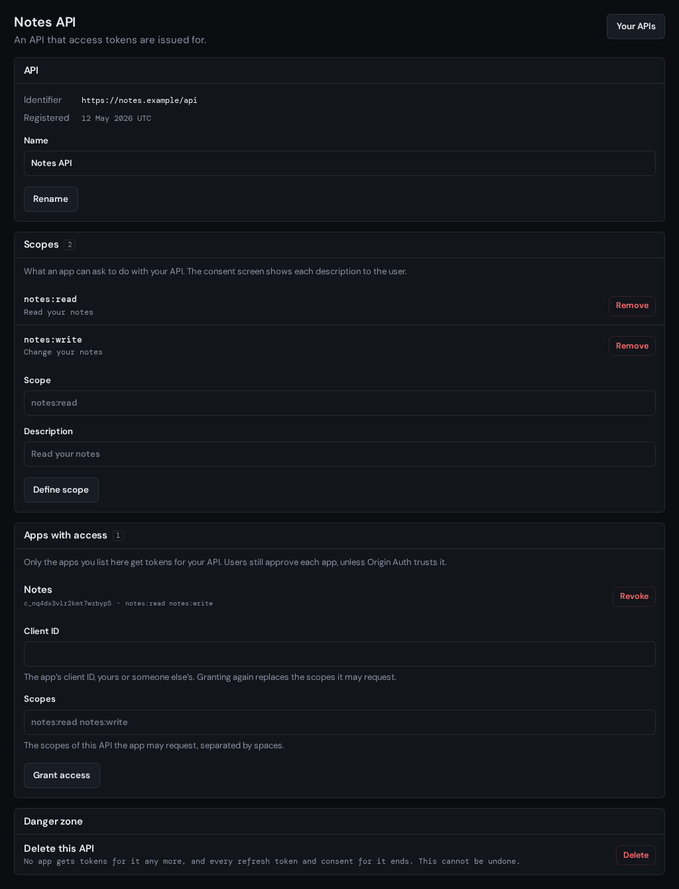
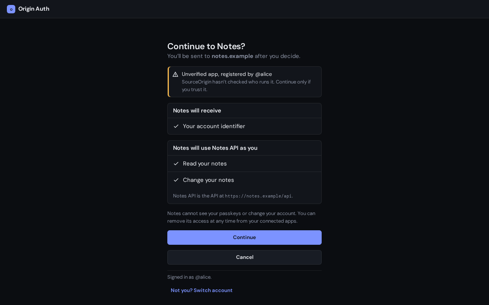

# Registering an API

Register your API with Origin Auth so apps can get access tokens made for it,
with scopes you define. Your API then accepts only tokens addressed to it, and
users see what each app asks to do there before they agree. Origin Auth calls
a registered API a resource, after OAuth's resource indicators (RFC 8707).

## Before you start

- You need an Origin Account with a passkey. Every change on this page asks you
  to confirm with it if you haven't used it in the last five minutes.
- Choose the API's **identifier**: an `https` address that names it, such as
  `https://notes.example/api`. It is the `aud` claim your API checks in every
  token. Nothing has to be served there, and it can't change later.
- Have the client ID of each app that should call the API. You find it on the
  [app's overview](register-an-app.md#connect-your-app).

An app that only calls its own backend doesn't need this page: without a
registered API, its access tokens are addressed to the app itself.
[Protecting an API](protect-an-api.md) covers both cases.

Operators register SourceOrigin's own APIs with `auth-service resource`, or on
the admin dashboard: see [OIDC clients](../../dev/operations/clients.md#apis).

## Register the API

1. Open the developer console, at `auth.sourceorigin.dev/developers`, and select
   **Your APIs**.
2. Under **Register an API**, fill in **Identifier**.
3. Fill in **Name**. Users see it when an app asks for access to your API.
4. Select **Register API**.

The API's own page opens, and says **The API was registered.**

## Define its scopes

A scope is one thing an app can ask to do with your API, such as `notes:read`.
Scopes are optional: without any, a token for your API says who the user is and
which app is calling, and nothing more.

1. On the API's page, under **Scopes**, fill in **Scope** with its name, as apps
   request it.
2. Fill in **Description** with what it allows, in the user's words, such as
   `Read your notes`. The consent screen shows it.
3. Select **Define scope**.

Defining a scope that exists replaces its description.

## Give an app access

Only the apps you list get tokens for your API, whoever registered them.

1. Under **Apps with access**, fill in **Client ID** with the app's client ID.
2. Fill in **Scopes** with the scopes the app may request, separated by spaces.
3. Select **Grant access**.



Granting again replaces the scopes the app may request.

## Ask for a token

The app names your API in the `resource` parameter of its sign-in, and asks for
the scopes it needs beside its own.

With the Rust SDK:

```rust
let (url, pending) = client
    .authorize(&AuthorizeRequest {
        scopes: "notes:read".parse()?,
        resource: Some(Resource::new("https://notes.example/api")?),
        ..AuthorizeRequest::default()
    })
    .await?;
```

With the TypeScript SDK:

```ts
const { url, pending } = await client.authorize({
  scopes: ['notes:read'],
  resource: 'https://notes.example/api'
});
```

With any other OpenID Connect library, add `resource=https://notes.example/api`
to the authorization request, as the
[reference](../reference/oidc.md#apis-and-the-resource-parameter) describes. A
device signing in [with a code](device-sign-in.md) sends it with its request for
the codes.

The user then sees what the app asks of your API, each scope by its
description:



One sign-in gets tokens for one API. An app that calls two signs the user in
once for each.

## Check that it works

Sign in to the app, and decode the access token it receives. Its `aud` is your
API's identifier, and its `scope` lists the scopes the user approved. Your API
[validates it](protect-an-api.md) with that identifier.

Under **Connected apps** in their settings, the user sees the app with a line
such as **Uses Notes API: Read your notes**.

## Change or remove it

Each change applies at once, on the API's page:

- **Rename** gives it another name on consent screens.
- **Remove** beside a scope takes it from the API and from what every app may
  request. A refresh token that holds it stops working at its next use.
- **Revoke** beside an app ends its access. Its refresh tokens for your API
  stop working, and it gets no new tokens for it.
- **Delete**, under **Danger zone**, removes the API. No app gets tokens for it
  any more, every refresh token for it stops working, and users' approvals of it
  are forgotten. It can't be undone.

Access tokens already issued stay valid until they expire, five minutes at
most.

## Limits

- An account can have 10 APIs, and each API 32 scopes.
- An identifier uses `https`, has no query, fragment, user name or password,
  and is at most 255 bytes. Write it as it normalizes:
  `https://notes.example/api`, not `https://NOTES.example/api`.
- A scope can't be named `openid`, `profile`, `email` or `offline_access`:
  those are Origin Auth's own.
- A name can't contain SourceOrigin's or another well-known brand.
- Deleting your account deletes your APIs.

## Troubleshooting

| What the app sees | Why | What to do |
| --- | --- | --- |
| `invalid_target` | The `resource` isn't a registered API, or the app has no access to it. | Check the identifier, character for character, and that the app is listed under **Apps with access**. |
| `invalid_scope` | The app asked for a scope it wasn't granted for this API, or for one of the API's scopes without naming the API. | Grant the scope to the app, and send `resource` with the request. |
| `invalid_target` at the token endpoint | A token request named another `resource` than its sign-in. | Send the same `resource`, or leave it out. |
