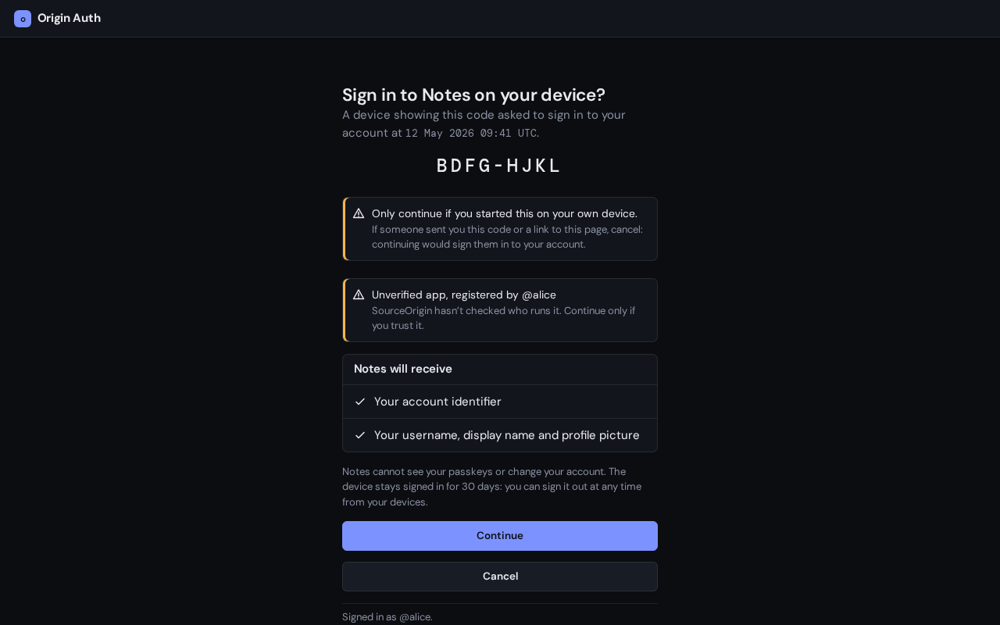

# Signing in on a device without a browser

Sign users in to an app that can't open a browser or receive a redirect, such
as a command-line tool, a TV app or a build machine. Your app shows a short
code, the user approves it on Origin Auth from their phone or computer, and
your app receives its tokens. This is the OAuth device authorization grant
(RFC 8628).

## Before you start

- You need an [app you registered](register-an-app.md), with **Device code**
  turned on under **Grant types** in its [settings](app-settings.md). An
  operator's client gets it with
  `--grant-type urn:ietf:params:oauth:grant-type:device_code`: see
  [OIDC clients](../../dev/operations/clients.md).
- Turn on **Refresh tokens** too, and keep the `offline_access` scope, if the
  device should stay signed in for longer than an access token's five minutes.
- A command-line tool or a TV app can't keep a secret, so register it as an app
  without a backend. It then sends its client ID alone.
- Every app still lists a redirect URI, even one that only uses this grant. A
  loopback URI such as `http://127.0.0.1/callback` works.

The SDKs don't run this grant yet ([#779](https://github.com/sourceorigin-dev/sourceorigin/issues/779)). The requests below are plain HTTPS, and
`curl` shows them.

## Ask for the codes

Post your client ID and the scopes you need to the
`device_authorization_endpoint` of the [discovery document](../reference/oidc.md):

```console
curl https://auth.sourceorigin.dev/oauth/device_authorization \
    -d client_id=c_nq4dx3vlr2kmt7wzbyp5 \
    -d scope="openid profile offline_access"
```

Origin Auth answers with two codes:

```json
{
  "device_code": "pdc_v1_01938f7c-….q3kX…",
  "user_code": "BDFG-HJKL",
  "verification_uri": "https://auth.sourceorigin.dev/device",
  "verification_uri_complete": "https://auth.sourceorigin.dev/device?user_code=BDFG-HJKL",
  "expires_in": 600,
  "interval": 5
}
```

- Keep `device_code` to yourself: it is what collects the tokens.
- Show the user `verification_uri` and `user_code`, and ask them to open the
  page and type the code. Where you can, show `verification_uri_complete` as a
  link or a QR code as well: it opens the page with the code filled in.
- Both codes work for `expires_in` seconds, ten minutes.

## Wait for the user

Poll the token endpoint every `interval` seconds with the device code:

```console
curl https://auth.sourceorigin.dev/oauth/token \
    -d grant_type=urn:ietf:params:oauth:grant-type:device_code \
    -d client_id=c_nq4dx3vlr2kmt7wzbyp5 \
    -d device_code="pdc_v1_01938f7c-….q3kX…"
```

Until the user decides, the answer is an error that tells you what to do next:

| `error` | What it means | What to do |
| --- | --- | --- |
| `authorization_pending` | The user hasn't decided yet. | Wait `interval` seconds and poll again. |
| `slow_down` | You polled before the interval had passed. | Add 5 seconds to your interval, for this poll and every later one, then poll again. |
| `access_denied` | The user refused. | Stop. Start again only if the user asks. |
| `expired_token` | The codes expired before the user decided. | Stop, and ask for new codes. |
| `invalid_grant` | The device code is unknown, another app's, or already collected its tokens. | Stop. |

Once the user approves, the same request answers with the tokens, as a
[code exchange](../reference/oidc.md#codes-tokens-and-consent) does: an access
token, an ID token when you asked for `openid`, and a refresh token when your
app has the **Refresh tokens** grant type and asked for `offline_access`. A
device code collects its tokens once.

## What the user sees

1. The user opens `auth.sourceorigin.dev/device`, signs in if they aren't, and
   types the code. Its case, dashes and spaces don't matter.
2. Origin Auth shows your app's name, what it asks to receive, the code and
   when the device asked, and warns: **Only continue if you started this on
   your own device.** It shows this every time, even for an app the user
   already approved, since a code someone else sent them would sign that person
   in.
3. The user selects **Continue**, or **Cancel**. The page then tells them to go
   back to their device.



## Keep the device signed in

The device gets a session of its own at Origin Auth, apart from the browser
that approved it. It lasts 30 days, like a browser's, and so does its refresh
token: after that, the user approves a new code.

- Refresh the access token with the refresh token, as any app does. An app
  without a backend gets a new refresh token with every refresh: keep the
  newest one.
- The user sees the device in their [devices](../account/devices.md), named
  after your app, and can sign it out there. Signing out the browser that
  approved it leaves the device signed in.
- To sign the device out yourself, [revoke](../reference/oidc.md) its refresh
  token.

## Check that it works

1. Run the two requests above with your client ID.
2. Open the `verification_uri_complete` you got, and select **Continue** twice.
3. Poll again: the answer holds your tokens.
4. Open your Origin Account's **Devices** settings: your app's device is
   listed.

## Troubleshooting

- **`unauthorized_client` when asking for the codes.** The app doesn't have the
  **Device code** grant type. Turn it on in its settings.
- **`invalid_scope`.** The app may not request one of the scopes. `scope` is
  required, and each scope must be on in the app's settings.
- **No refresh token.** The app needs the **Refresh tokens** grant type, and
  the request must ask for `offline_access`.
- **The page says "No device is waiting for this code."** The code was
  mistyped, already used, or older than ten minutes. Ask for new codes.
- **The page says "Too many codes tried."** A browser may look up ten codes a
  minute. Wait a minute.
