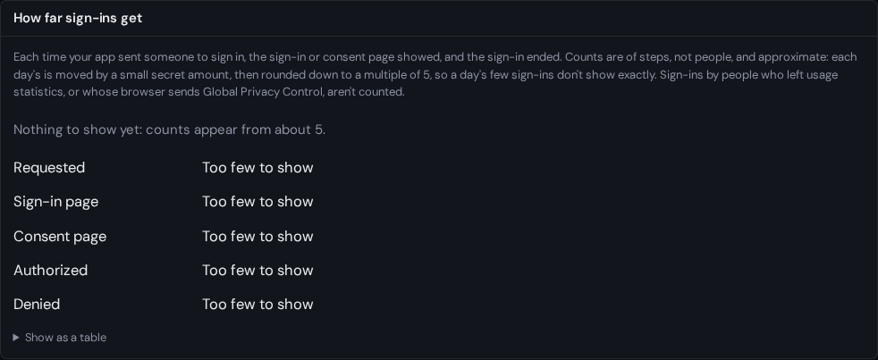

# Seeing how your app is used

Your app's **Insights** tab, in the developer console, shows how far people
get when they sign in to it, and the tokens it was issued, over its last 30
whole days. Use it to see where people stop, such as at the consent page.

## Before you start

- You need an app you [registered](register-an-app.md). Open it from **Your
  apps**, at `auth.sourceorigin.dev/developers`, then select its **Insights**
  tab.
- Of the developer console's users, only you see your app's insights, and only
  of your app.

## Read where sign-ins stop

**How far sign-ins get** counts each step of signing in to your app:

| Step | Counted when |
| --- | --- |
| **Requested** | Your app sent someone to sign in, or started a sign-in on its own page. |
| **Sign-in page** | The sign-in page showed. It can show more than once in one sign-in. |
| **Consent page** | The consent page showed. |
| **Authorized** | The sign-in ended with your app getting its code. |
| **Denied** | The person declined. |

Fewer **Authorized** than **Requested** means people stopped on the way: the
**Sign-in page** and **Consent page** counts show where.

The counts are of steps, not people: one person can reach a step more than
once. They are also approximate, so that a day's few sign-ins don't show
exactly: each day's count is moved by a small secret amount, then rounded down
to a multiple of 5, and the days are added up, shown as **About 25**. A step
whose every day rounded down to none shows as **Too few to show**. A day's
steps move together, so on any one day, a step reached less often never shows
more than one reached more often. Over 30 days, a count can be off by a few
tens: an app with 3 sign-ins in a month sees **Too few to show** about half the
time, and **About 5** or more otherwise. Sign-ins by people who left
[usage statistics](../your-data/usage-statistics.md), or whose browser sends
Global Privacy Control, aren't counted, and neither is an app checking in the
background, with `prompt=none`, whether someone is still signed in.

## Read your tokens

**Tokens issued** charts, per day, each token response your app received:
**Code exchanges**, for a sign-in, and **Refreshes**, with a refresh token.
Your app receives these itself, so they are exact, and they count everyone.
**Show as a table**, below the chart, lists each day's numbers.

## When counts change

Both cards cover whole days, in UTC. A day's counts show once it has ended
and its last sign-ins have been counted, by 02:00 UTC the next day, all at
once, never one sign-in at a time.

## Troubleshooting

- **Insights aren't available on this server.** The server you use doesn't
  read its analytics back. On SourceOrigin's own, it always does.
- **Insights couldn't be read just now.** The analytics database didn't
  answer. Your app still signs people in: try again in a minute.
- **Nothing to show yet.** Every step's days rounded down to none in the
  last 30 whole days.
